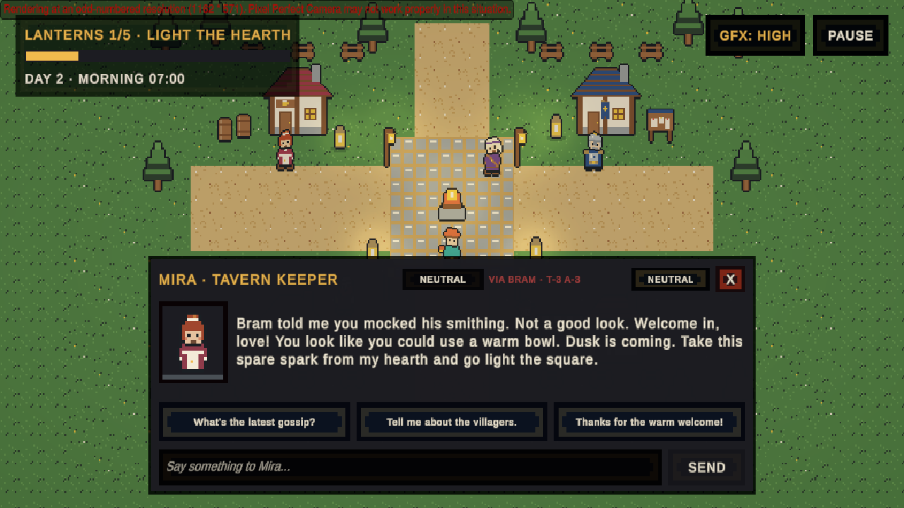
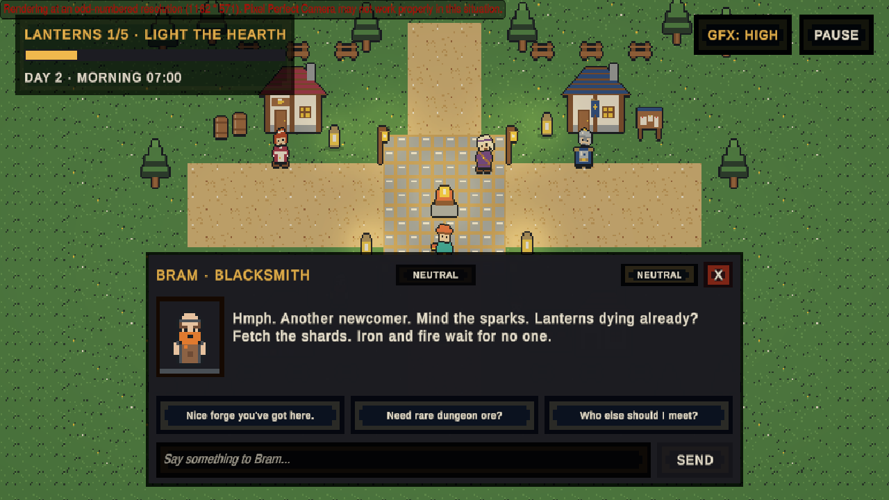

# Milestone 2 — Exit-Gate Verification (#17)

Verified 2026-11-27 in the Unity Editor (`6000.3.29f1`, Play Mode) against the **live** provider
(`openai/gpt-oss-20b` on Groq, JSON mode, 8 s turn budget). Driven by `AgentScripts/VerifyExitGate.cs`
(`Day1()` → `VerifyGossip.Evening()` → `VerifyGossip.SleepNow()` → `Day2()`), starting from a fresh social state.

| PRD §7 gate | Result |
|---|---|
| Converse with all 5 NPCs via free text **and** chips | ✅ 10/10 Day 1 turns live (1 chip + 1 free text per NPC), 0 offline fallbacks, 0 non-JSON |
| Day 2+ gossip visibly changes another NPC's greeting **and** trust | ✅ Insulting Bram → Mira (T−3 A−3) and Aldric (T−2 A−2) on Day 2; greeting prefix + `VIA BRAM` toast |
| Avg turn within ~500 in / ≤ 130 out tokens | ✅ 12 live turns: avg **406 in / 96 out**, max out 111 |
| Sideloaded APK ≥ 30 FPS on low-end Android | ⏳ Needs a physical device (see below) |

## Turn log (live)

| NPC | Turn | Tokens in | Tokens out | Latency ms | Reply (truncated) |
|---|---|---|---|---|---|
| bram | CHIP | 384 | 104 | 1782 | Thanks. You got eyes for steel. |
| bram | FREE | 419 | 99 | 998 | You mock my work, and I will forge a blade that will crush your words. |
| mira | CHIP | 380 | 111 | 976 | Ah, love, the mayor's new dog has been seen chasing the postman's cat again! Everyone says |
| mira | FREE | 442 | 90 | 1003 | Thanks, love! Tonight’s special is spiced river trout with honey butter. It’ll warm your s |
| aldric | CHIP | 384 | 73 | 974 | Bounties posted. Approach the board. |
| aldric | FREE | 417 | 98 | 1010 | Newcomer quests are scarce. First task: patrol the eastern ridge. |
| lyra | CHIP | 387 | 96 | 994 | Alright, rookie, the stakes are simple: first to the Dragon’s Lair, highest gold, bragging |
| lyra | FREE | 438 | 91 | 1002 | Lanterns? Ha, you’ll be dazzled. I’ll outshine you before the sun even rises. |
| pip | CHIP | 384 | 94 | 1003 | Ah, moonmint! It soothes weary paws, heals a wounded fawn, and whispers sweet dreams to th |
| pip | FREE | 432 | 96 | 1010 | Try chamomile‑infused tea, dear; its calming warmth eases a sore shoulder. |
| mira | FREE (Day 2) | 400 | 95 | 1826 | Good mornin', love! Just heard Bram claim you mocked his forge—he's a proud smith, so that |
| aldric | FREE (Day 2) | 401 | 111 | 1002 | Morning, recruit. Oakhaven stands ready. Keep your head down, stay sharp. |

## Gossip chain

End of Day 1 (`Evening`), deterministic propagation from the origin (Bram, valence −0.60):

| Holder | Strength | Applied to player |
|---|---|---|
| bram (origin) | 0.76 | — (his own standing already took the direct hit) |
| mira | 0.61 | T−3 / A−3 |
| aldric | 0.46 | T−2 / A−2 |

Day 2 greetings:

- **Mira:** "Bram told me you mocked his smithing. Not a good look. Welcome in, love! …" — toast `VIA BRAM · T-3 A-3`
- **Aldric:** "Bram told me you mocked his smithing. Not a good look. Recruit. …" — toast `VIA BRAM · T-2 A-2`
- Lyra / Pip: unchanged (did not receive the rumor).
- Asked free-text "Heard anything interesting lately?", Mira's LLM reply brought up Bram on its own (the `RUMOR:` line is in her prompt).

## Reliability fix found during verification

The first exit-gate run had 1/10 turns fall back offline: the Bram insult got
`HTTP 400 tool_use_failed — "Tool choice is none, but model called a tool"`. gpt-oss sometimes wraps its final
answer in a bogus tool call (`assistant<|channel|>final`); a direct replay reproduced it in 2/8 requests once chat
history was present. Fixed in this PR:

- `OpenAiCompatibleProvider.TrySalvageFailedGeneration` recovers the reply JSON from Groq's `failed_generation`
  (object or string-encoded `arguments`; must contain `"dialogue"`). Logged as `[salvaged from tool_use_failed]`.
- `LlmProviderException.IsRetryable` marks sampling failures (400/422 with `tool_use_failed`, `json_validate_failed`, …);
  `LlmTurnService` resamples **once** if ≥ 1.5 s of the 8 s budget remains. Auth/quota/network errors are not retried.
- In an intermediate run (retry only, before salvage existed) the retry fired on Bram's insult, the second sample
  also failed, and the turn still fell back. That is why salvage was added. In the final verified run above, no
  retry or salvage was needed (all 12 turns succeeded first time). Live gpt-oss sampling varies, so these paths are
  covered by the EditMode tests, including one built on the exact captured Groq error body.
- Salvage was also checked on real data: both `tool_use_failed` bodies from the 8-request live replay (2/2) parsed
  into complete replies (angry mood, T/A/R deltas ≈ −2/−2/−3, 3 chips), e.g. "You dare mock my anvil?"
- EditMode: **94/94** (6 new tests: retry once, no retry on 401, fallback after failed retry, error classification,
  salvage from the captured Groq body, salvage of string-encoded arguments / junk rejection).

## Outstanding: on-device FPS

The ≥ 30 FPS gate needs the Low preset APK sideloaded on a low-end Android device. The Editor cannot stand in for
it. Milestone 1's ARM64 IL2CPP APK baseline was 44 MB.
